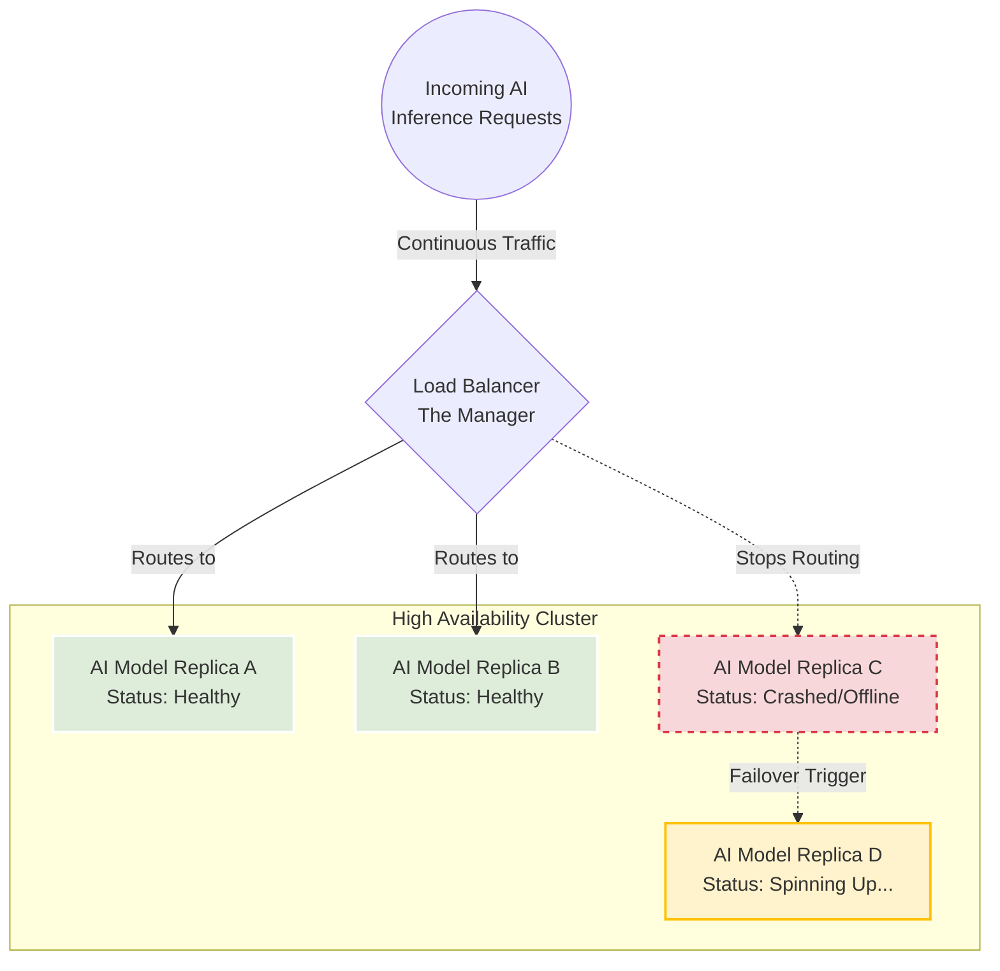
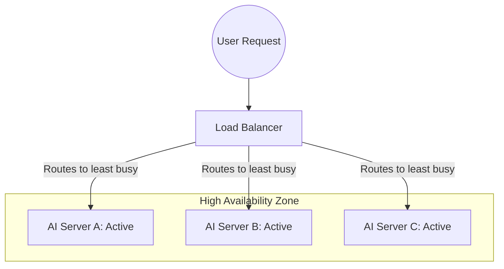
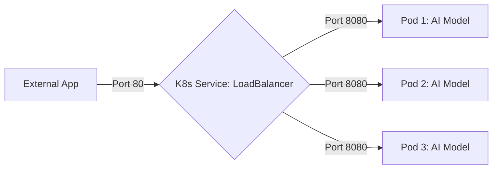
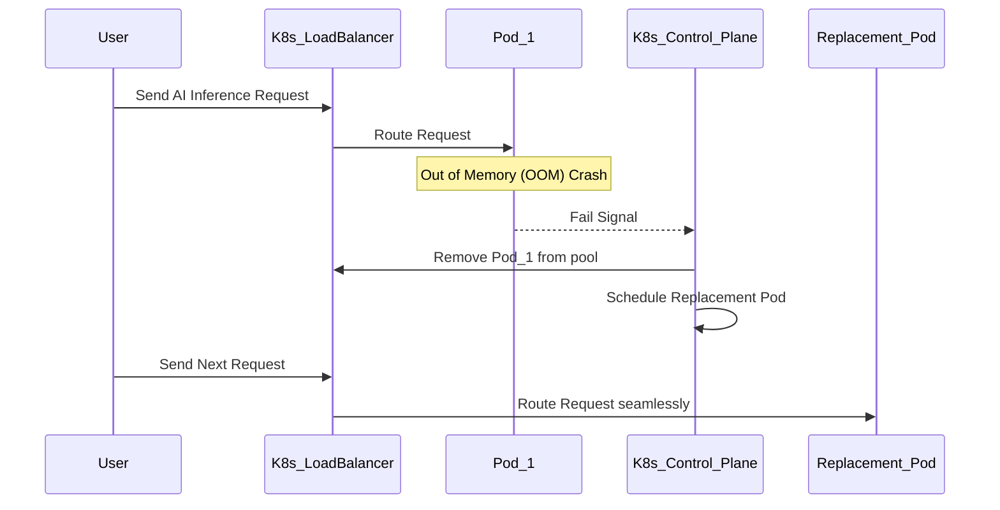

# Load Balancing and High Availability

**Session Time:** 120 minutes

---

## Table of Contents
1. Defining Load Balancing and High Availability Concepts
2. Implementing Basic Load Balancing for Distributed AI Applications
3. Analyzing System Logs to Verify Performance Under Load and Failover Conditions
4. Lab: Kubernetes Cluster Deployment
5. Wrap-Up and Reflection

---

## Learning Objectives

By the end of this module, participants will be able to:

1. Define load balancing and high availability concepts.
2. Implement basic load balancing for distributed AI applications.
3. Analyse system logs to verify performance under load and failover conditions.

---

## Session Breakdown

| Segment | Topic                                                                          | Duration (minutes) |
|---------|--------------------------------------------------------------------------------|--------------------|
| 1       | Defining Load Balancing and High Availability Concepts                         | 20                 |
| 2       | Implementing Basic Load Balancing for Distributed AI Applications              | 20                 |
| 3       | Analyzing System Logs to Verify Performance Under Load and Failover Conditions | 20                 |
| 4       | Lab: Kubernetes Cluster Deployment                                             | 60                 |

---

## 1. Defining Load Balancing and High Availability Concepts

Maintaining continuous **uptime** is critical for AI service delivery. We will examine load balancing techniques and strategies for ensuring high availability, designing redundant, failover-ready systems.

### Core Concepts

* **High Availability (HA):** 
  
  An architecture design that ensures a system operates continuously without failing for a designated period. 
  
  In an AI context, if an instance processing a computationally heavy machine learning model fails, a backup instance takes over instantly to prevent service disruption.


* **Load Balancing:** 
  
  The method of distributing incoming network traffic across a group of backend servers or nodes. This prevents any single node from being overwhelmed, which is especially important for latency-sensitive AI inferences.


### The Supermarket Checkout Analogy

Imagine a busy supermarket on a holiday weekend. Customers are continuously walking up to the front with full carts, ready to check out.

**Load Balancing is the Floor Manager**

If all customers tried to use a single cash register, the line would stretch to the back of the store, and people would abandon their carts (timeout errors). To prevent this, the Floor Manager (the **Load Balancer**) stands at the front. As each customer arrives, the manager points them to the register with the shortest line. This ensures the work is distributed evenly across all cashiers, preventing any single person from being overwhelmed.

**High Availability is the Backup Plan**
What happens if Cashier #2 suddenly gets sick and has to close their lane? In a standard setup, the customers in that line are stuck. In a **High Availability (HA)** setup, the supermarket is prepared for failure. The manager immediately redirects the affected customers to the other open registers, and a backup cashier in the breakroom is instantly paged to take over Register #2. The store never stops checking people out, and the overall system survives the failure without closing the doors.

### The Technical Translation for AI Systems

When we apply these concepts to AI infrastructures:

* **Customers:** 
  
  Incoming user requests (e.g., asking an AI to generate an image or summarize text).

* **Cashiers:**
  
  Your AI worker nodes or Kubernetes Pods running the heavy machine learning models.

* **Floor Manager:** 
  
  The Load Balancer (like an AWS Application Load Balancer or Kubernetes Service) routing network traffic.

* **The Breakroom Backup:** 
  
  Automated orchestration (like Kubernetes ReplicaSets) spinning up replacement containers instantly when a failure is detected.

### Architecture Diagram

Here is how this looks in a system architecture:



> By combining these two strategies, you ensure your AI applications can handle massive spikes in user traffic (Load Balancing) while remaining resilient against inevitable hardware or software crashes (High Availability).


### Tools Used: Kubernetes Concepts

While we will deploy these practically in the next section, **Kubernetes** provides the foundational tools to understand these concepts. It manages "ReplicaSets" to ensure high availability, automatically replacing failed containers. 

In Kubernetes, the **ReplicaSet** has a sole purpose to constantly monitor your cluster and ensure that a specified number of identical Pods (your AI models or applications) are running at all times. It provides "self-healing" by automatically replacing Pods that crash, get deleted, or are terminated due to node failures.

### A Short Technical Example

Instead of manually deploying 3 separate pods one by one, you give the ReplicaSet a set of instructions (a YAML file). You say, "Make sure there are always 3 pods labeled `ai-fraud-model` running."

```yaml
apiVersion: apps/v1
kind: ReplicaSet
metadata:
  name: fraud-model-replicaset
spec:
  replicas: 3 # The golden rule: Always have 3 running
  selector:
    matchLabels:
      app: ai-fraud-model
  template:
    metadata:
      labels:
        app: ai-fraud-model
    spec:
      containers:
      - name: fraud-model-container
        image: my-registry/fraud-model:v1

```

> [!NOTE]
> In modern Kubernetes, you rarely create a ReplicaSet directly. Instead, you create a **Deployment** (which we discussed in previous modules), and the Deployment automatically creates and manages the ReplicaSet for you!*


### Practical Example
Imagine an AI image generation API. Without load balancing, 500 concurrent users hitting a single server will cause the GPU memory to overflow, resulting in a crash. By utilizing high availability concepts, those 500 requests are distributed evenly across 10 redundant servers, ensuring continuous AI service delivery.



---

## 2. Implementing Basic Load Balancing 

To put theory into practice, you must implement basic load balancing for distributed AI applications. This involves creating a unified access point that intelligently routes traffic to healthy AI model replicas.

### Tools Used: Minikube and Kubernetes Services

* **Kubernetes (`Service` Object):** 
  
  In Kubernetes, load balancing is achieved by defining a `Service`. A service of type `LoadBalancer` automatically provisions a routing mechanism to distribute requests among the Pods it targets.

* **Minikube:** 
  
  Minikube is used to run a local Kubernetes cluster. It provides a command, `minikube tunnel`, which simulates an external load balancer's IP address for local testing.

### Practical Example

To load balance a distributed AI sentiment analysis model, you create a Kubernetes Service YAML file. When applied, Kubernetes exposes the service and balances the traffic across all pods labeled `app: ai-sentiment`.

```yaml
apiVersion: v1
kind: Service
metadata:
  name: ai-sentiment-lb
spec:
  type: LoadBalancer
  selector:
    app: ai-sentiment
  ports:
    - protocol: TCP
      port: 80
      targetPort: 8080

```



---

## 3. Analyzing System Logs to Verify Performance

Deploying a load balancer is not enough; you must analyse system logs to verify performance under load and failover conditions. Continuous monitoring ensures the load balancing is actively working and that failover triggers correctly when an AI workload crashes.

### Tools Used: kubectl

* **`kubectl logs`:** Retrieves the stdout/stderr logs from a specific container.
* **`kubectl get events`:** Retrieves the chronological stream of events in the cluster, such as pod creation, scaling, or crash looping.

### Practical Example

If an AI model pod runs out of memory under heavy load, Kubernetes will terminate it and start a new one. You can use `kubectl` to verify this failover condition.

1. Simulate a failover by deleting an active pod: `kubectl delete pod ai-sentiment-1234`
2. Watch the load balancer redirect traffic and Kubernetes self-heal the cluster:

```bash
# Verify failover events 
kubectl get events --watch

# Analyze the logs of the newly created replacement pod to ensure the AI model initialized correctly
kubectl logs -l app=ai-sentiment

```



---

## 4. Lab: Kubernetes Cluster Deployment

**Objective:** Kubernetes Cluster Deployment – Deploy and scale a service using Minikube and Kubernetes. This lab demonstrates orchestration fundamentals and how workloads are managed dynamically.

*(Please refer to the lab platform for complete instructions, starter code, and access to Minikube).*

---

## 5. Wrap-Up and Reflection

**Reflection Question:**

When an AI application takes significantly longer to process certain inputs (like large images) compared to others, how does this affect the efficiency of a simple "round-robin" load balancer, and what might you look for in the system logs to diagnose this issue?

---

## Resources

* [Kubernetes Service Types and Load Balancing](https://kubernetes.io/docs/concepts/services-networking/service/)
* [Minikube: Accessing Apps via LoadBalancer](https://minikube.sigs.k8s.io/docs/handbook/accessing/)
* [Kubernetes: Application Introspection and Debugging](https://kubernetes.io/docs/tasks/debug/)
