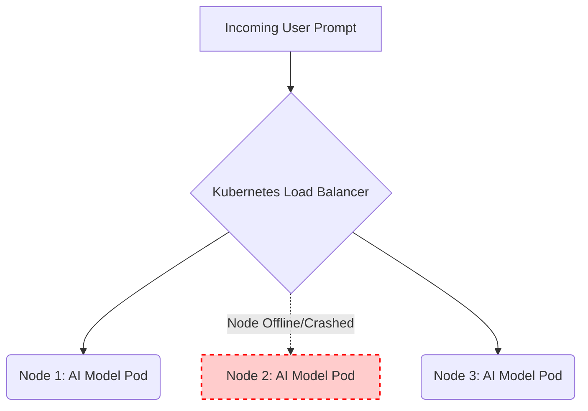

# Instructor Guide: Load Balancing and High Availability

## Module Overview

In this module, instructors will guide learners as they examine load balancing techniques and strategies for ensuring high availability. The focus is on learning to design redundant, failover-ready systems that ensure continuous AI service delivery under heavy traffic or hardware failure.

## Learning Objectives

By the end of this session, learners will be able to:

* Define load balancing and high availability concepts.
* Implement basic load balancing for distributed AI applications.
* Analyse system logs to verify performance under load and failover conditions.

## Session Pacing Guide (120 Minutes total)

| Duration   | Segment                                | Instructor Action                                                                                                                                                                                          |
|------------|----------------------------------------|------------------------------------------------------------------------------------------------------------------------------------------------------------------------------------------------------------|
| **20 min** | **Defining HA & LB Concepts**          | Define the concepts of High Availability and Load Balancing. Use analogies (e.g., supermarket checkout) to explain how traffic distribution prevents AI model bottlenecks.                                 |
| **40 min** | **Implementing & Analyzing**           | Live demonstration: Create a Kubernetes `LoadBalancer` Service and expose it using `minikube tunnel`. Delete a running AI pod manually and use `kubectl get events` and `kubectl logs` to verify failover. |
| **60 min** | **Lab: Kubernetes Cluster Deployment** | Facilitate the lab. Guide learners to deploy and scale a service using Minikube and Kubernetes, demonstrating orchestration fundamentals and how workloads are managed dynamically.                        |

---

## Delivery Notes & Teaching Tips

### 1. The Supermarket Checkout Analogy

* **Simplifying Concepts:** Explain load balancing as a "Supermarket Manager" directing incoming inference requests to different backend AI pods so that no single node gets overwhelmed.
* **AI Specifics:** Point out that AI inferences are computationally expensive. Without a load balancer, subsequent requests queue up linearly behind slow requests, causing timeout errors for users.

### 2. High Availability Mindset

* **Expect Failure:** Teach the "Chaos Engineering" mindset. Hardware fails, and nodes crash. High Availability isn't about preventing failure; it's about designing a system that survives it gracefully.

---

## Common Student Issues & Solutions

| Issue                                                                                                                            | Potential Cause                                                                                      | Solution                                                                                                                                |
|----------------------------------------------------------------------------------------------------------------------------------|------------------------------------------------------------------------------------------------------|-----------------------------------------------------------------------------------------------------------------------------------------|
| **External IP is `<pending>**`                                                                                                   | Kubernetes is waiting for a cloud provider to assign an IP, but the lab is running Minikube locally. |
| Instruct the student to open a separate terminal and run `minikube tunnel` to simulate the external load balancer IP allocation. |
| **Connection Refused**                                                                                                           | The `targetPort` in the Service YAML doesn't match the port the AI container is listening on.        | Verify the container's exposed port (e.g., FastAPI on 8000) and update the `targetPort` accordingly in the configuration.               |
| **Cannot find logs after crash**                                                                                                 | The pod was deleted or restarted, and a standard `kubectl logs` command fails.                       | Teach learners to use the `--previous` flag (`kubectl logs -p <pod_name>`) to view logs of a crashed container before it was restarted. |
| **Traffic hitting only one pod**                                                                                                 | Test requests are too infrequent to trigger round-robin routing clearly.                             | Use a load testing tool or a fast `while` loop with `curl` to generate enough continuous traffic to observe the distribution.           |

---

## Debrief Questions

1. "During the Kubernetes Cluster Deployment lab, how did Minikube and Kubernetes dynamically manage the workloads when you scaled the deployment up?" 

2. "Why is analyzing system logs critical immediately *after* a failover event occurs?" 

3. "If a load balancer distributes traffic evenly, what happens if one AI model replica takes 1 second to infer, but another takes 15 seconds due to a complex prompt?"

---

## Resources for the Instructor

* **Reference:** 
  * [Kubernetes Service Types and Load Balancing](https://kubernetes.io/docs/concepts/services-networking/service/)
  * [Minikube: Accessing Apps via LoadBalancer](https://minikube.sigs.k8s.io/docs/handbook/accessing/)
* **AI Prompt Bank:** Keep these handy to share with students who are stuck:
  * *"Generate a basic Kubernetes Service YAML of type LoadBalancer that targets pods labeled 'app: ai-api'."*
  * *"Explain the difference between a ClusterIP and a LoadBalancer in Kubernetes simply."*